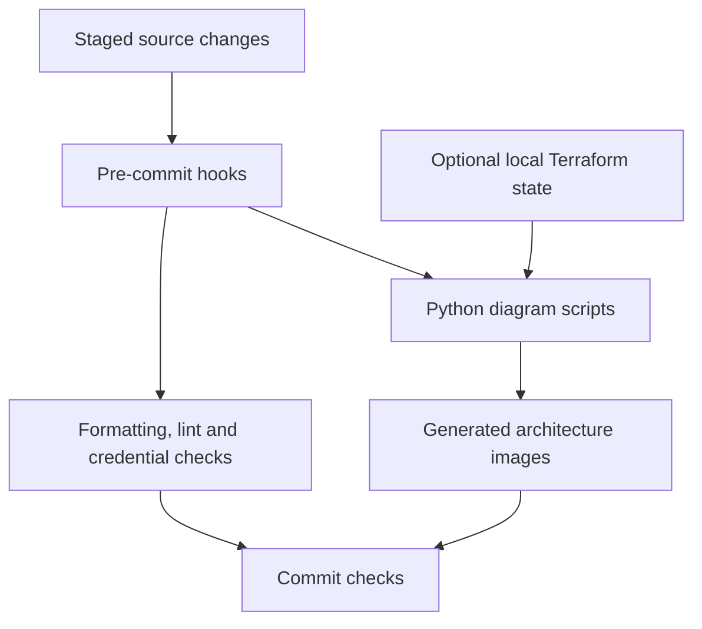

# Automations with Hooks

A Git pre-commit toolkit for checking source files and regenerating AWS architecture illustrations. It combines formatting, linting, credential checks and Python-based diagram generation.

**Status:** The repository contains hook scripts and illustrative diagrams; it does not deploy an AWS application. The Pytest hook is currently commented out.

## Architecture

## Start here

Install Graphviz and the Python dependencies with `pip install -r requirements.txt`, then run `pre-commit install`. Review [.pre-commit-config.yaml](.pre-commit-config.yaml) for enabled checks and [diagrams/](diagrams/) for the example infrastructure.

[Previous README and detailed reference](README_REFERENCE.md). This historical material may describe older setup assumptions or unmerged plans; the scope above reflects this branch.
